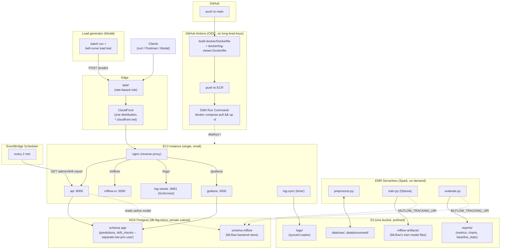

# Cloud deployment: AWS (training via EMR Serverless, stack on EC2)

> Working plan document, not the finished deployment doc. `docs/DEPLOYMENT.md` gets rewritten from this once the plan is fully implemented and verified.

## Context

Local training has become slow and resource-heavy enough to disrupt other work on the machine (confirmed this session: a single 30-trial Optuna search took the better part of an hour, plus a genuine Spark cluster bug -- cross-container writes on Windows Docker Desktop silently dropping model files). This plan moves training and the always-on stack to AWS.

## Why AWS, not Modal.com

- **Training**: Modal's multi-node clustering is GPU-only -- it explicitly does not support CPU-only clustered functions, so it can't run a distributed Spark cluster at all. AWS **EMR Serverless** runs `train.py`/`preprocess.py`/`evaluate.py` close to unchanged, pay-per-second, nothing charged while idle.
- **Always-on stack** (API, MLflow UI, dashboards): Modal has no equivalent to a persistent, internally-networked multi-service stack. AWS does.
- **Batch inference**: splits two ways. Bulk Spark-native scoring is already one parallel job -- EMR Serverless, not Modal. Replaying rows through the live API as many independent calls *is* Modal's strength -- that's its one role here, as client only (Phase 2).

## Workflow: 4 phases, 4 Linear sprints, staging branch

1. **Training** (MLflow + Spark/EMR Serverless)
2. **Inference** (load generator + the serving stack -- "serving stack" is the always-on EC2 stack built in this phase, not EMR; EMR (Phase 1) only ever runs the ephemeral training jobs, never serving traffic)
3. **Logging, monitoring, drift, visualization**
4. **CI/CD**

Each phase = one Linear sprint, independently testable. Each sprint's tasks go on their own feature branch(es), PR'd into a `staging` branch (new -- created from current `main`) at sprint end. Test `staging`; if it's good, mark the sprint's Linear tasks done and PR `staging` into `main`. Repeat per phase -- `main` gets updated incrementally after each sprint passes, not once at the very end. Existing repo rules still apply: `main` stays PR-protected, feature branches never deleted after merge. Linear issues get created once this plan is approved (not from within plan mode).

## Phase 1: Training

- `src/config.py`: paths become environment-overridable (prerequisite for everything else):
  ```python
  DATA_RAW_DIR = Path(os.environ.get("DATA_RAW_DIR", PROJECT_ROOT / "data" / "raw"))
  MLFLOW_TRACKING_URI = os.environ.get("MLFLOW_TRACKING_URI", f"sqlite:///{MLFLOW_DB_PATH}")
  ```
  No env vars set = today's local behavior, unchanged. Also keeps anything PII/credential-shaped out of the (public) repo's defaults -- real values only ever live in the cloud environment's own env vars, never committed.
- S3 bucket, three prefixes: `data/` (raw + processed), `mlflow-artifacts/` (MLflow's own model files -- same content verified locally this session), `reports/` (`evaluate.py`'s metrics/charts/baseline_stats, not an MLflow artifact).
- RDS Postgres (`db.t4g.micro`), private subnet -- fully managed, not a second EC2 instance to run/SSH into yourself. Replaces `mlflow.db`; this project already hit real SQLite-locking bugs locally, don't repeat that. MLflow's tables go in their own `mlflow` schema (connection string sets `search_path`), not the Postgres default `public`.
- Ad hoc SQL access to it: no AWS console query UI here -- that's an Aurora Serverless-only feature (its Data API), and this is a standard instance. Access via SSM port-forwarding through the EC2 instance (no bastion, no open port -- same no-SSH pattern as Phase 4's deploys) to a local client (psql, DBeaver, TablePlus). Grafana (Phase 3) already covers the `app` schema for dashboards; this is just for occasional manual queries.
- EMR Serverless Spark application; confirm its supported Spark/Python version against `pyspark==3.5.3`, or use its custom-image support to run `docker/Dockerfile` directly if available on the release used.
- Submit `preprocess.py`/`train.py`/`evaluate.py` as EMR Serverless jobs against the S3 paths and RDS-backed `MLFLOW_TRACKING_URI`.
- Nothing to shut down between runs: EMR Serverless has no persistent worker nodes to stop -- it provisions workers per job and releases them automatically when the job ends. Billed per-second of actual job runtime, not for idle capacity.
- IaC: OpenTofu (genuinely open source, MPL 2.0, vs. Terraform's source-available BUSL license; drop-in compatible, low-risk to switch either direction later).

## Phase 2: Inference

- Compute: single EC2 instance (`docker-compose`), not ECS/Fargate -- closest to local, cheapest, least new surface area. `c5.xlarge` (4 vCPU, 8GB, compute-optimized, non-burstable) -- not a `t3`: api's `/predict` path runs through an embedded Spark `local[*]` session (JVM task scheduling + Py4J serialization per call, not a lightweight inference path), so throughput scales with vCPU count, and a `t3`'s CPU credit balance risks draining mid-run under the load test's sustained traffic (below), contaminating the result. See infra/variables.tf's `ec2_instance_type`.
- Why not host the API/MLflow UI/dashboards on EMR Serverless instead, to skip a second piece of compute: doesn't work -- EMR Serverless runs ephemeral batch Spark jobs, not long-running network services, and has no way to expose a persistent listener for FastAPI/MLflow UI/Grafana. It's also not actually cheaper: Phase 1's training jobs already scale to zero between runs, so there's no idle EMR capacity to reclaim -- this EC2 instance is the cheap always-on piece by design, sized for exactly this light workload.
- Cloud compose file: `api`, `mlflow-ui`, `log-viewer`, `nginx` -- **not** `spark-master`/`spark-worker`/`pipeline` (EMR Serverless replaces that role).
- `set_active_model.py --version N` runs as a one-off container on the same EC2 instance the API runs on (Phase 2's compute, below) after each training run, pulling the winning model from RDS+S3 into local `models/active/` on that instance. `api` reads it from local disk, same as today -- EMR (Phase 1) never serves traffic, it only runs the training jobs and exits.
- `predictions` table, new: same RDS Postgres instance as Phase 1's MLflow backend (not a second database), its own `app` schema + low-privilege user (not MLflow's `mlflow` schema -- avoids write-load coupling and keeps a clean blast radius). `src/api/app.py`'s `predict()` writes one row per successful call: `review_title`, `review_text`, `sentiment`, `probability`, `client_ip`, `user_agent`, `api_key_id` (which pooled key made the call -- see the load generator below), `received_at` and `responded_at` (both timestamps, so `responded_at - received_at` gives serving time), and `model_version`/`run_id` (the active MLflow model that scored it, joinable back to MLflow's own tables). `review_text_length` dropped -- derivable from `review_text` on read, no need to store it. Pooled connection, not one per request.
- `log_requests` middleware: add `client_ip` to every entry (currently missing). These stay local files on the EC2 instance from the moment they're written -- EMR never sees them; it has no role in serving or logging, only the Phase 1 training jobs. They reach S3 the same way as everything else here, via Phase 3's periodic `aws s3 sync`.
- **Load generator (Modal)**, two jobs:
  - **The real ~3.5M-row batch run** (and any future one): calls the live `POST /predict` through CloudFront with bounded concurrency (tuned empirically against what the EC2 instance can sustain -- not unbounded, not artificially throttled either). Never touches RDS/S3 directly -- the API records results server-side, same as any other caller.
  - **A load test**: 20 minutes, bell-curve traffic reaching ~1,000 concurrent simulated sessions at peak (ramping up and down, not a step function). Each session stays live 4 minutes: an initial request of a random 10-20 rows, then a 5-row batch every 1 minute for the rest of the session -- ~30 rows and 4 requests per session, each row drawn once from a pool that **excludes every row used in training** (not just "the dataset" loosely) -- see below.
    - **Rows needed**: by Little's Law (concurrency = arrival rate x session length), a bell curve peaking at 1,000 concurrent with a 4-minute session length works out to roughly 2,000-2,500 total sessions over the 20-minute run -- **60,000-75,000 rows drawn**. Peak request rate implied: ~1,000 requests/minute (~17 req/s) -- the number actually worth validating against what `c5.xlarge` can sustain.
    - **Excluding training data**: local training only ever touched a 5% sample of `train.parquet` (143,991 + 35,679 = 179,670 rows, via `src/scripts/make_training_sample.py`). That leaves 3,420,330 clean rows in `train.parquet` plus the full 400,000 in `test.parquet` -- 3,820,330 untouched rows total, far more than the ~75,000 needed (under 2% of the clean pool). The load generator's row pool must be built from these untouched rows specifically, not just "most of the dataset" -- track which rows training actually sampled (the same seed=42 reproduces it) and exclude exactly those, not an approximation.
    - **API keys**: a single shared key doesn't model 1,000 distinct concurrent callers realistically. Needs a pool generated up front -- extend `src/scripts/generate_api_key.py` to batch-generate N keys, and the API to accept any key from that set (small `api_keys` table or list, replacing today's single `API_KEY` env var check); the load generator assigns one per session, or round-robins a smaller pool.
    - **WAF interaction to watch**: Modal's calls come from a limited/shared set of egress IPs, not 1,000 distinct client IPs, so the per-IP rate-based WAF rule (Edge, below) needs a threshold that tolerates concentrated legitimate load-test traffic, or those IPs need an allowlist -- otherwise the WAF rate-limits the load test itself before it reaches the API.
- Edge: WAF (rate-based rule, blocks a single IP over a threshold) in front of one CloudFront distribution, origin = the EC2 instance's nginx. Default `*.cloudfront.net` domain -- no custom domain needed; a bare ALB/EC2 DNS name can't get a *trusted* cert (ACM requires proving domain ownership), CloudFront's default domain gets one automatically.
- `GET /health` stays unauthenticated (ALB/CloudFront health checks can't send a custom secret header) -- the WAF rule + `client_ip` logging above is the actual answer to "who's hitting this," not gating a liveness probe a flood would ignore anyway.

## Phase 3: Logging, monitoring, drift, visualization

- Logs: local rotating files, unchanged, synced to S3 every few minutes (`aws s3 sync`) so they survive the EC2 instance being replaced/resized. Safe to run against a file still being written -- each sync just uploads what changed since the last one; worst case on instance loss is losing whatever was written since the *last* sync, nothing earlier.
- **Three dashboards, two tools** -- Grafana does not parse logs and does not replace `log-viewer`:

  | Dashboard | Tool | Reads from | Charts |
  |---|---|---|---|
  | Requests | GoAccess (`log-viewer`, unchanged) | `logs/api_requests.log` | hits & unique users over time, status-code breakdown, top paths, response times |
  | Predictions | Grafana | `app.predictions` | sentiment split, confidence histogram, volume over time |
  | Drift | Grafana | `app.drift_checks` | PSI per signal over time, status + sample_size over time |

- **Drift, redesigned**: the always-on internal `asyncio` loop inside the API process is removed. Instead:
  1. **Trigger**: an EventBridge Scheduler rule calls `GET /admin/drift-report` every **2 minutes**.
  2. **Compute + save**: that call reads the last `window_seconds` of `app.predictions` (now **120s / 2 min**, matching the trigger cadence -- shrunk again from the earlier 900s/15-min default; tradeoff gets sharper at this cadence: a 2-minute window needs real sustained traffic to clear `MIN_SAMPLE_SIZE` (30) at all, so at anything below roughly 15 predictions/minute most checks will report `insufficient_data` rather than a real verdict -- only meaningful once the load generator (or real traffic) is actually running), computes PSI against the stored baseline (`compute_psi()`, unchanged), inserts one row into `app.drift_checks`, and returns that result as the HTTP response too.
  3. **Query + display**: Grafana reads `app.drift_checks` on demand, whenever the dashboard is viewed/refreshed -- it doesn't drive the checks itself, it just plots whatever rows already exist from step 2.
  - `drift.py`'s `_tail_recent_predictions()` is rewritten to query `app.predictions` instead of tailing the log file -- cleaner now that structured records live in Postgres.
  - Why a separate `drift_checks` table rather than computing PSI live in a Grafana panel: PSI is Python logic (baseline-bucket comparison), not expressible as raw SQL -- something has to run it and persist the result for Grafana to plot a trend.
- Grafana: one data source (RDS `app` schema) -- no Prometheus needed anywhere in this plan. Routed through the same nginx + CloudFront as the other dashboards (`/grafana/`).
- **One thing to verify before trusting the single-CloudFront-distribution design**: MLflow UI, GoAccess, and Grafana all normally expect to be served from the root path. Under nginx path-stripping (`/mlflow/`, `/logs/`, `/grafana/`), each needs its own sub-path support confirmed against the actual version deployed: MLflow's `--static-prefix` flag, Grafana's `root_url`/`serve_from_sub_path` config (most mature of the three), and GoAccess's WebSocket reconnection through a prefixed proxy. Fallback for whichever doesn't cooperate: a separate CloudFront distribution just for that one service (no prefix complexity, one extra URL) -- cost difference between one distribution and several is negligible (CloudFront bills on requests/data transfer, not distribution count).

## Phase 4: CI/CD

- GitHub Actions, OIDC federation to an IAM role -- no long-lived AWS keys as GitHub secrets. Mechanics: an IAM OIDC identity provider trusting `token.actions.githubusercontent.com`, plus one IAM role whose trust policy is scoped to this repo and branch (`repo:pdg-stack/amazon_reviews_sentiment_predictor-sparkML:ref:refs/heads/main`), carrying only the permissions this workflow needs (ECR push, SSM SendCommand). The workflow calls `aws-actions/configure-aws-credentials` with `role-to-assume: <that role's ARN>` -- no access key/secret ever stored in GitHub.
- On merge to `main` (i.e., after a phase's staging round passes and gets PR'd in): build `docker/Dockerfile` + `docker/log-viewer.Dockerfile`, push to ECR (two repos or one repo/two tags), then AWS Systems Manager Run Command (not SSH -- no open port needed) runs `docker compose pull && docker compose up -d` on the EC2 instance.
- **AWS account**: `183088117536`, region `us-east-1` (confirmed). **S3 bucket**: `arsp-183088117536-us-east-1` (account-id suffix guarantees global uniqueness -- rename if you'd rather). **GitHub OIDC trust**: scoped to `pdg-stack/amazon_reviews_sentiment_predictor-sparkML`, `main` branch (mechanics above). **Modal**: account already configured locally (`--profile=pdg-stack`); its token stays local/in GitHub secrets, never in this plan or the repo.
- **How I get AWS access**: run `aws configure` (or `aws configure sso`) in your own terminal, for an IAM user/role scoped to what OpenTofu needs -- commands then run through this session's shell, which inherits that config. Don't paste access keys into chat.

## Architecture

Mermaid source below -- renders on GitHub/GitLab/VS Code-with-extension/the Mermaid Live Editor.



`set_active_model.py --version N` (not shown as its own box): runs as a one-off container on the EC2 instance after each training run, pulling the winning model from RDS+S3 into local `models/active/`, which `api` reads from.

## Status as of 2026-10-28

- **Phase 1**: infra code written (S3/RDS/EMR Serverless/ECR via OpenTofu); actual EMR Serverless run never executed -- validated locally instead. Local active model: version 3 (0.876 acc / 0.943 AUC).
- **Phase 2 & 3**: EC2/RDS/CloudFront/WAF were provisioned, API/nginx/compose/Grafana code written, then **all AWS infrastructure was torn down** (verified independently) to stop incurring cost. Code exists in the repo; nothing is currently deployed.
- **Phase 4**: not started.
- `.env.aws` contains stale connection strings from the destroyed RDS instance -- needs regenerating before any future apply.
