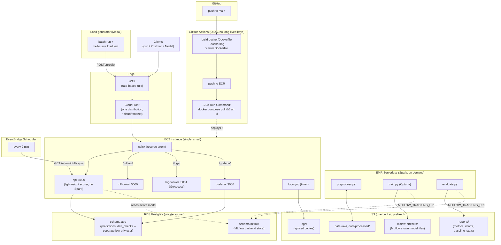

# Deployment

What's running and how to work with it. See [`docs/diagrams/aws-architecture.html`](diagrams/aws-architecture.html) for an interactive diagram of everything described below.

## The shape of it

Training runs as an on-demand AWS EMR Serverless Spark job -- no cluster sits running between jobs, it provisions workers per job and releases them when done. Everything else (the FastAPI server, MLflow UI, log dashboard, Grafana) runs as Docker containers on one small EC2 instance, reachable only through a CloudFront distribution with a WAF rate-limit rule in front -- nothing is exposed directly to the internet. The API scores every `/predict` call with `src/serving/lightweight_scorer.py` -- a pure-Python scorer with no Spark/JVM involved -- not an embedded Spark session; see `docs/ARCHITECTURE_NOTES.md` for why. A scheduled EventBridge rule checks for prediction drift every 2 minutes; a systemd timer backs the logs up to S3 every 5 minutes. Pushing to `main` on GitHub rebuilds and redeploys the two custom images automatically, via OIDC (no AWS keys stored anywhere in GitHub).

There's no SSH anywhere in this design. Every "get onto the instance and run something" action goes through AWS Systems Manager (SSM) -- Run Command for one-off commands, Session Manager for a port-forward tunnel. That means there's no open port 22 to secure, patch, or worry about.



`set_active_model.py --version N` (not shown as its own box): runs as a one-off container on the EC2 instance after each training run, pulling the winning model from RDS+S3 into local `models/active/`, which `api` reads from -- it also exports `lightweight_model.json` at the same time (see `src/serving/export_lightweight_model.py`).

## Finding the pieces that move

Three things change if the infrastructure is ever torn down and recreated -- always re-check these rather than trusting an old value you remember:

```
cd infra
tofu output cloudfront_domain       # the public URL everything below assumes
tofu output ec2_instance_id          # for every aws ssm command below
tofu output rds_endpoint             # for direct DB access
```

## Reaching the dashboards

Everything is served from the one CloudFront domain, path-routed by nginx:

| Path | What |
|---|---|
| `/predict`, `/health`, `/metrics` | the API itself |
| `/mlflow/` | MLflow UI (experiment runs, registered model versions) |
| `/grafana/` | Predictions + Drift dashboards (reads `app.predictions`/`app.drift_checks`) |
| `/logs/` | GoAccess request dashboard -- a periodically-regenerated static snapshot (see `docs/OBSERVABILITY.md` for why it isn't push-live) |

## Database access (DBeaver, psql, etc.)

RDS has no public access by design -- the only way in is through the EC2 instance, via an SSM port-forward tunnel from your own machine:

```
# MLflow UI, if you'd rather hit it directly than through CloudFront:
aws ssm start-session --target <ec2_instance_id> \
  --document-name AWS-StartPortForwardingSession \
  --parameters '{"portNumber":["5000"],"localPortNumber":["5000"]}'

# Postgres (both the `mlflow` and `app` databases live on the same RDS instance):
aws ssm start-session --target <ec2_instance_id> \
  --document-name AWS-StartPortForwardingSessionToRemoteHost \
  --parameters '{"host":["<rds_endpoint>"],"portNumber":["5432"],"localPortNumber":["5432"]}'
```

With that second tunnel open, point DBeaver (or `psql`) at `localhost:5432` -- not the real RDS hostname, the tunnel is what makes `localhost` reach it. Database `mlflow` (user `mlflow_admin`) holds MLflow's backend store; database `app` (user `app_user`) holds `predictions`/`drift_checks`. Credentials are in `.env.aws` (gitignored) -- regenerate with `tofu output -raw rds_password`/`tofu output -raw app_db_password` if you don't have a copy.

The [Session Manager plugin](https://docs.aws.amazon.com/systems-manager/latest/userguide/session-manager-working-with-install-plugin.html) needs to be installed locally for `aws ssm start-session` to work at all (`winget install Amazon.SessionManagerPlugin` on Windows).

## Deploying a code change

**The normal path**: push to `main`. `.github/workflows/deploy.yml` builds `docker/Dockerfile` and `docker/log-viewer.Dockerfile`, pushes both to their ECR repos, then runs `git pull && docker compose pull && docker compose up -d` on the instance via SSM Run Command -- no manual step needed.

**Manually, if you need to** (e.g. testing a change before it's merged):

```
aws ssm send-command --instance-ids <ec2_instance_id> \
  --document-name AWS-RunShellScript \
  --parameters commands='["cd /home/ec2-user/app","git pull","docker compose -f docker-compose.cloud.yml up -d --build"]'
```

`--build` there builds locally on the instance instead of pulling from ECR -- useful for trying out an unmerged branch; `main`'s real deploys always pull pre-built images.

**One gotcha that cost real debugging time**: nginx and the other containers bind-mount config files and the repo itself from the host. `git pull` replacing a file on disk doesn't make an *already-running* container see the new content -- Docker's single-file bind mounts can keep pointing at the old inode. `docker compose up -d --force-recreate <service>` (not just `up -d`) is what actually picks up a changed bind-mounted file.

## Training a new model version

```
aws emr-serverless start-job-run \
  --application-id <emr_application_id> \
  --execution-role-arn <emr_execution_role_arn> \
  --job-driver '{"sparkSubmit": {
    "entryPoint": "local:///workspace/docker/emr_train_job.py",
    "entryPointArguments": ["--train-path", "s3://<bucket>/data/processed/train_5pct.parquet",
                             "--eval-path", "s3://<bucket>/data/processed/eval_5pct.parquet",
                             "--cv-folds", "5", "--n-trials", "30",
                             "--reports-s3-prefix", "s3://<bucket>/reports"],
    "sparkSubmitParameters": "--conf spark.emr-serverless.driverEnv.MLFLOW_TRACKING_URI=<from .env.aws> --conf spark.emr-serverless.driverEnv.MLFLOW_ARTIFACT_ROOT=s3://<bucket>/mlflow-artifacts"
  }}'
```

If training itself succeeds but the job still fails, `docker/emr_evaluate_job.py` re-runs just the evaluation + report-upload for an already-registered version, without repaying for the whole Optuna search:

```
--entryPoint "local:///workspace/docker/emr_evaluate_job.py"
--entryPointArguments ["--version", "1", "--eval-path", "...", "--reports-s3-prefix", "..."]
```

Once a version is registered and evaluated (its `baseline_stats.json` needs to exist in `docs/reports/version_N/` -- pull it from `s3://<bucket>/reports/version_N/baseline_stats.json` if it only landed in S3), activate it on the live API the same way as local dev, just run as a one-off container on the EC2 instance instead of your own machine:

```
docker compose -f docker-compose.cloud.yml run --rm api python src/serving/set_active_model.py --version N
docker compose -f docker-compose.cloud.yml restart api
```

## Running a load test

`src/scripts/modal_load_test.py` runs for real against the live CloudFront URL -- a 20-minute bell curve of simulated sessions peaking at 1,000 concurrent, drawing review text from the held-out `test.parquet` pool (never the training data), one API key per simulated session from a generated pool:

```
python src/scripts/generate_api_key.py --count 200   # once, writes API_KEYS to .env
modal run src/scripts/modal_load_test.py
```

**What to expect**: a full 20-minute run at the 1,000-concurrent peak completes with every request succeeding (8,728/8,728 in the last confirmed run, 0 failures) and the database row count matching the expected math (sessions x rows/session) almost exactly. The lightweight scorer is what makes this hold -- see `docs/ARCHITECTURE_NOTES.md` for why an embedded-Spark-session serving path couldn't.

The WAF rate limit (`infra/edge.tf`'s `rate_based_statement.limit`) is already sized for this traffic shape -- Modal's calls come from a small, shared set of egress IPs rather than 1,000 distinct ones, so the load concentrates onto very few source IPs.

## Tearing it down

```
cd infra
tofu destroy
```

Everything here is defined as OpenTofu resources with no manual console changes, so `destroy` removes it cleanly. Nothing recurring keeps billing once this runs -- EMR Serverless already scales to zero between jobs, so the EC2 instance, RDS instance, CloudFront distribution, and NAT/EIP are the only things that cost anything while sitting idle, and all of them are removed. Re-running `tofu apply` afterward recreates everything, but note the three values in "Finding the pieces that move" above will all change (new instance, new RDS endpoint, new CloudFront domain) -- update `.env.aws` and any bookmarked URLs accordingly.

## What this doesn't handle (yet)

- **Zero-downtime deploys**: `docker compose up -d` recreates a container in place; there's a brief gap while the new one starts. Fine for this project's traffic, not a rolling-deploy setup.
- **Multi-region / HA**: everything is one EC2 instance and one RDS instance, single-AZ. A real outage of either takes the whole stack down. Acceptable for a personal/demo project, not a production SLA.
