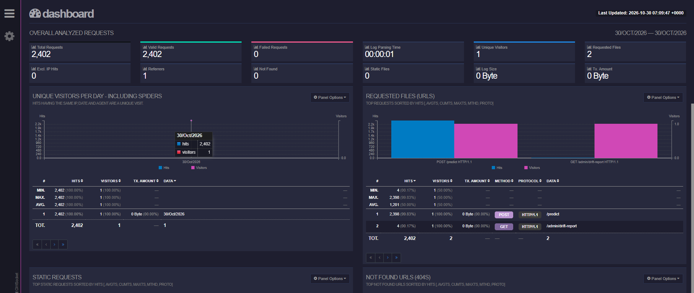
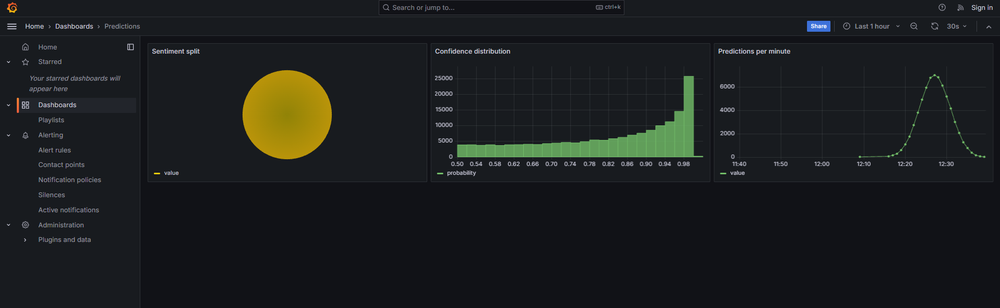
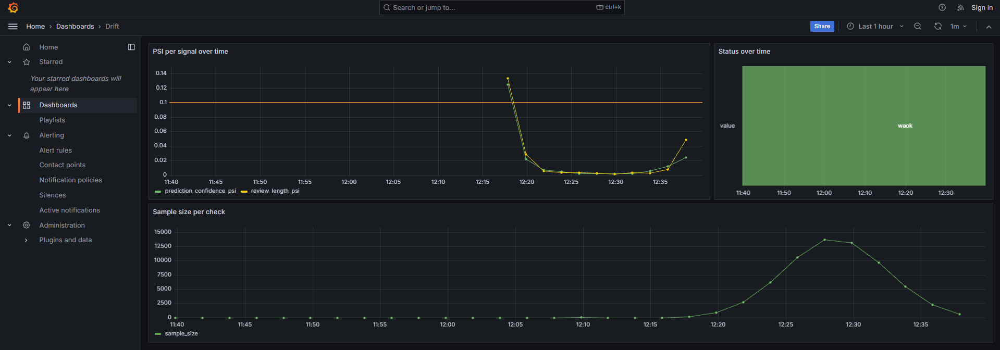

# Observability

How the API's logging, metrics, and automated drift check work — an addition on top of the training and serving pipeline described in [`ARCHITECTURE_NOTES.md`](ARCHITECTURE_NOTES.md).

## Logging

The API writes a log entry for every request it handles. Routine liveness checks and metrics scrapes go to their own file, `logs/api_probes.log`, so they don't drown out real traffic; everything else — including failed requests — goes to `logs/api_requests.log`. Both files are written by a `RotatingFileHandler` (`src/api/logging_config.py`, 10MB cap, 5 backups kept) so neither can grow without limit. All of this happens in one place, the `log_requests` middleware in `src/api/app.py`, so both successful and failed requests are covered the same way.

**`logs/api_requests.log`** — one JSON line per entry:

```json
{"timestamp": "...", "event": "access", "method": "POST", "path": "/predict", "status": 401, "latency_ms": 3.1, "client_ip": "...", "user_agent": "...", "api_key_id": "a1b2c3d4", "input": {"text": "..."}}
```

`api_key_id` is a short, non-reversible fingerprint (`sha256(key)[:8]`, see `src/api/app.py`'s `_api_key_id()`) of whatever `X-API-Key` header was sent — valid or not, present or absent (`null` if there was no header at all). It exists because `client_ip` usually can't distinguish callers here: in the cloud deployment it's always nginx's own container IP (every request reaches the api container *from* nginx, not from the real caller), and even where a real IP is visible, a load generator calling from a small shared pool of egress IPs would still collapse to a handful of "visitors" regardless. Each simulated caller in `src/scripts/modal_load_test.py` is assigned its own key specifically so this field — not IP — is what actually identifies a distinct caller; GoAccess's dashboard (below) keys its "unique visitors" count off this field for exactly that reason.

`event` is `"access"` for most entries, or `"predict"` for a *successful* `/predict` call, which carries more detail:

```json
{
  "timestamp": "...", "event": "predict", "method": "POST", "path": "/predict", "status": 200, "latency_ms": 812.4,
  "client_ip": "...", "user_agent": "...", "api_key_id": "a1b2c3d4",
  "input": {"text": [...], "title": [...]},
  "results": [{"sentiment": "positive", "probability": 0.87}],
  "review_text_lengths": [14]
}
```

`review_text_lengths` is the word count of the combined `title + text` string the model actually scored (matching how `preprocess.py` builds that field at training time) — this is what the drift check compares against the training-set baseline, not the raw input.

A **failed** `/predict` call (bad payload → 400, wrong key → 401, or a server-side error → 500) still records what was sent, under `input`, even though there's no `results` to report — useful for seeing what a client sent that caused the failure. This works even for a bad-key request, which never reaches the code that normally builds that detail, because the request body is read once, up front, in the middleware itself, before anything else runs.

**`logs/api_probes.log`** — a lighter entry for every `GET /health` and `GET /metrics` hit:

```json
{"timestamp": "...", "method": "GET", "path": "/metrics", "status": 200, "latency_ms": 0.4}
```

Three loggers exist in `src/api/logging_config.py`: `api.requests` (the first file above), `api.probes` (the second), and `api.app` (printed to the console — startup messages, drift-check warnings and errors).

### Browsing the logs

For a quick live view, [Logdy](https://logdy.dev) (open source, self-hosted) can tail either file straight into a browser with no setup. For actual analysis — charts of request volume, status codes, and response times over time, not just a live feed — the `log-viewer` service (in both `docker-compose.yml` locally and `docker-compose.cloud.yml` in the cloud deployment) runs [GoAccess](https://goaccess.io) (also open source) against `logs/api_requests.log` and serves a dashboard, at `http://localhost:8081` locally or `/logs/` on the cloud deployment's CloudFront domain (see `docs/DEPLOYMENT.md`). GoAccess expects a well-known access-log format, so a small script (`src/scripts/tail_to_clf.py`) converts this project's JSON lines into that format on the fly — the log file itself doesn't need to change. That conversion puts `api_key_id` (see above), not `client_ip`, into the access-log format's "host" field — so GoAccess's own "Unique Visitors" panel is actually counting distinct callers, not distinct IPs, which here would mostly collapse to one.



*The dashboard mid-way through a real load test. "Unique Visitors: 1" in this particular capture predates the `api_key_id`-based visitor identification described above — taken against an earlier build, it's showing the `client_ip`-based count collapsing to one caller, exactly the problem that change fixes.*

**Two cloud-specific wrinkles**: GoAccess's own embedded web server (the port it listens on, `7890`) serves a WebSocket for live updates, not general page requests — a plain page load against it gets flatly rejected. The real dashboard content is the single static HTML file GoAccess writes to disk (`logs/log-viewer-report.html`, self-contained, no external assets), which nginx serves directly in the cloud deployment instead of proxying to that port.

The second wrinkle follows from the first: `--real-time-html` only ever rewrites that file in response to a connected WebSocket client. Since nginx serves the file directly instead of proxying to GoAccess's httpd, no WebSocket client ever connects — so the file sat byte-for-byte unchanged, not just at idle but through an entire live load test's worth of real traffic. (`--html-refresh=<secs>` does **not** fix this, despite seeming like it should — it only controls how often an already-open browser tab reloads the page, which just re-fetches the same frozen file; it has no effect on whether GoAccess's backend ever rewrites it.) The actual fix, in the cloud compose file only: drop `--real-time-html`/the WebSocket entirely, and instead loop a one-shot (non-real-time) GoAccess batch render of the current log every 15 seconds (`sh -c "while true; do ...; sleep 15; done"`, see `docker-compose.cloud.yml`). `src/scripts/tail_to_clf.py --once` feeds that loop a fresh snapshot each time rather than following the log forever. Locally, none of this applies — a browser hits GoAccess's own embedded httpd directly, so `--real-time-html`'s WebSocket genuinely connects and that service keeps `--html-refresh=10` as originally intended.

### Predictions and drift dashboards (Grafana, cloud deployment only)

Two more dashboards exist only in the cloud deployment (`/grafana/` on the CloudFront domain), reading directly from the `app` schema on RDS Postgres rather than from log files:

- **Predictions**: sentiment split, confidence histogram, prediction volume over time — from the `app.predictions` table, written by every successful `/predict` call (one row per text scored; see `src/api/db.py`).
- **Drift**: PSI per signal over time, plus status and sample size — from the `app.drift_checks` table, written by every `GET /admin/drift-report` call (see below for what triggers that).

Why a database instead of files for these two: Grafana reads SQL, not JSON log lines, and a table of structured rows is also what makes the PSI trend over time queryable at all — the drift check below computes one PSI value per call, and something needs to persist that history for a trend line to exist.



*Mid-load-test, with predictions-per-minute clearly tracking the test's bell-curve traffic shape. The "Sentiment split" pie renders as a single undifferentiated circle here rather than two labeled slices — taken before a fix for a real Grafana piechart gotcha: by default it reduces each numeric field to one aggregate value rather than slicing per row, collapsing `sentiment`/`value` into a single "value" slice instead of splitting by `sentiment`. `options.reduceOptions.values: true` (now set in `grafana/provisioning/dashboards/json/predictions.json`) fixes it.*



*The PSI spike crossing the 0.10 warning line near the start reflects the load test's traffic pattern differing from the training-time baseline (see "Reading a report" below) — exactly the kind of signal this dashboard exists to surface. The "Status over time" panel's `waok` label is two adjacent state segments' text (a `warning` segment and the `ok` segment next to it) overlapping at this zoom/width, not a real status value — zooming the time range in (the picker now works, see the fix above) separates them.*

## Metrics

`GET /metrics` (Prometheus's plain-text format, via `prometheus-fastapi-instrumentator`, no authentication needed — same as `/health`) exposes:

- Request counts and response-time histograms per endpoint, method, and status code, added automatically by the instrumentator.
- `active_model_version` — which model version is currently live, read from `models/active/ACTIVE_MODEL.json` at startup and again on every `/admin/reload-model` call.
- `prediction_drift_psi{feature=...}` — the latest drift score per signal (explained below), updated each time the background check runs.

**One limitation worth knowing**: these numbers are held in the process's own memory. If this API were ever run as multiple worker processes instead of the single one it uses today, each worker would report its own numbers rather than a combined total — not a concern for the current setup, just worth knowing if that ever changes.

## Model drift

There's no way to check whether live predictions are *correct* — nobody labels incoming reviews in real time. What this measures instead is whether the *shape* of live traffic (how confident the model tends to be, how long the reviews tend to be) still resembles the shape of the data the model was evaluated on. A shift is a signal worth a human look, not proof that the model is wrong.

**How it works:**

1. `evaluate.py` builds a baseline from the held-out test set: a distribution of (a) how confident the model was in its predicted class — the same number already logged as `results[].probability` above — and (b) how long each review's combined text was, in words. Both are written to `docs/reports/version_N/baseline_stats.json`.
2. `set_active_model.py --version N` copies that file to `models/active/BASELINE_STATS.json` whenever it activates version N, so the baseline on disk always matches whichever model is actually serving requests. If a version was registered before this baseline-capture code existed, activation prints a warning and drift checks report `"unavailable"` until that version is re-evaluated.
3. `GET /admin/drift-report` computes a check **on demand, right now** — it does NOT run on a timer inside the API process (there used to be an internal `asyncio` background loop; it was removed once this moved to the cloud, see below for why). Whoever/whatever calls this endpoint looks at the last `window_seconds` (120s / 2 minutes by default) of successful `/predict` calls and compares their confidence and length distributions against the baseline, using a statistic called the **Population Stability Index (PSI)**, which measures how much a distribution has shifted from a reference one. A higher PSI means a bigger shift. The result is both returned as the HTTP response AND saved as one row in `app.drift_checks` (Postgres, via `src/api/db.py`) — Grafana's Drift dashboard reads that table, it never calls this endpoint itself.

**Who actually calls it on a schedule**: in the cloud deployment, an AWS EventBridge rule (`infra/scheduler.tf`) calls this endpoint every 2 minutes — an external trigger, not internal process state. This matters for *why* it's designed this way: a scheduled HTTP call is restartable, inspectable in CloudWatch, and doesn't tie drift-checking to the API process's own lifetime (a restart no longer means "drift checking stopped and nobody noticed"). Locally, with nothing hitting this endpoint on a schedule, drift just never gets checked automatically — call it yourself with `curl` when you want a fresh number, which is the right trade-off for a setup with no always-on scheduler.

**Reading a report** (`GET /admin/drift-report`, needs the `X-API-Key` header):

```json
{
  "status": "ok",
  "sample_size": 42,
  "window_seconds": 120,
  "checked_at": "...",
  "metrics": {"prediction_confidence_psi": 0.04, "review_length_psi": 0.11}
}
```

`status` follows the standard convention for reading a PSI score: under 0.1 is `"ok"`, 0.1 to 0.25 is `"warning"`, and 0.25 or above is `"alert"` — whichever of the two signals scores worse decides the overall status. Two other statuses can appear before any PSI is even computed: `"unavailable"` (no baseline exists yet for the active model — step 2 above hasn't run) and `"insufficient_data"` (fewer than 30 predictions in the time window — a PSI score computed on a handful of samples is mostly noise).

**Worth knowing**: a 2-minute window needs real sustained traffic — roughly 15+ predictions per minute — to clear that 30-sample minimum at all; below that, most checks will report `"insufficient_data"` rather than a real verdict. That's expected, not a bug, and was confirmed directly: a live 20-minute load test against the deployed stack produced real `"alert"` results (PSI ~4.1 on prediction confidence) once traffic was flowing, and `"insufficient_data"` again as soon as it stopped. Treat any `"warning"` or `"alert"` you do see as illustrative rather than statistically rigorous, and don't read too much into an `"ok"` result from a tiny sample either.

"Alerting" here just means a log line at `WARNING` level (via the `api.app` logger) plus the non-`"ok"` status above — there's no email or chat notification built in. The Prometheus gauge could be connected to an alerting tool later if this ever needs to notify someone directly, but that isn't built now.

## What this doesn't do

- **It doesn't track accuracy.** Nothing here can tell you whether predictions are *correct* — that needs labeled ground truth on live traffic, a separate and much heavier process this project doesn't build.
- **It doesn't cover batch scoring.** `predict.py`, the command-line batch tool, doesn't write to either log file and isn't part of the drift check — this is entirely about the live `/predict` endpoint.
- **`/metrics` itself still has no permanent *metrics* store behind it.** Grafana (cloud deployment) reads `app.predictions`/`app.drift_checks` directly — that's a database of application-level records, not a Prometheus-style time-series store. Nothing currently scrapes `/metrics` into Prometheus/CloudWatch/etc.; it's exposed and ready to be scraped by one if you add it yourself, but isn't today.
